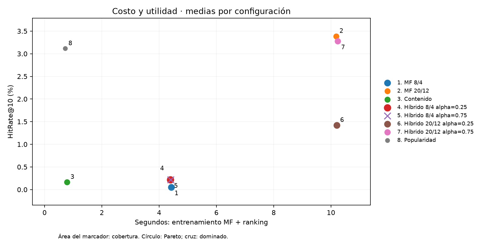

# INF-8239 · LAB08 + LAB09 · Sistemas recomendadores

**Victor Perez · Ciencia de Datos II · UASD.** Proyecto académico basado en la arquitectura docente de Edwin Ramón José Nolasco. Compara popularidad, TF-IDF de géneros, factorización y combinación híbrida sobre MovieLens Latest Small.

[Informe PDF (4 páginas)](output/pdf/Informe_Recomendadores.pdf) · [Notebook ejecutado](notebooks/LAB08_LAB09.ipynb) · [Conclusión](docs/CONCLUSION.md) · [Dataset Card](docs/DATASET_CARD.md) · [System Card](docs/SYSTEM_CARD.md) · [Declaración de IA](docs/AI_USAGE.md)

El informe sigue el formato del documento personal «Unidad 02. Ejercicio 03 - Victor_Perez»: tamaño carta, Calibri, títulos azules, secciones numeradas, tablas con rejilla fina y encabezado/pie académico. Incluye nombre completo y matrícula de la referencia. El generador usa Calibri si está instalado y Helvetica como alternativa; no redistribuye archivos de fuentes ni el documento anterior.

## Reproducir desde cero

Instalar [uv](https://docs.astral.sh/uv/getting-started/installation/) y ejecutar desde esta carpeta:

```bash
uv python install 3.12
uv sync --locked
uv run pytest -q
uv run python scripts/download_data.py
uv run python scripts/audit_data.py
uv run python scripts/build_notebook.py
uv run python scripts/build_report.py
```

El entorno `.venv` se crea automáticamente. `build_notebook.py` crea y **ejecuta** el notebook con nbclient: entrena todas las configuraciones, guarda métricas y verifica pruebas. Puede tardar varios minutos según el equipo. Necesita un kernel local Jupyter y permiso para abrir sus puertos locales. El notebook se puede abrir y ejecutar directamente con Jupyter/VS Code; al iniciarlo se descarga MovieLens si falta. Los artefactos publicados proceden de ejecución real con Python 3.12.14, Windows 11, el 23 de octubre de 2026. Los tiempos varían entre equipos.

Alternativa pip, dentro de un entorno Python 3.12:

```bash
python -m pip install -r requirements.txt
python -m pip install --no-deps -e .
python scripts/download_data.py
python scripts/build_notebook.py
python scripts/build_report.py
```

`requirements.txt` incluye herramientas de notebook, informe y pruebas. `requirements-cloud.txt` contiene dependencias de la aplicación. `uv.lock` fija el entorno completo. No se incluyen rutas personales ni dependencias locales en los archivos requirements.

## Ejecutar por laboratorio

```bash
uv run python scripts/lab08_content.py
uv run python scripts/lab09_hybrid.py --factors 20 --epochs 12 --alpha 0.25 --seed 42
uv run python scripts/lab09_hybrid.py --factors 20 --epochs 12 --alpha 0.75 --seed 42
uv run python scripts/run_experiments.py
uv run streamlit run app/streamlit_app.py
```

`lab08_content.py` conserva la consulta individual del laboratorio. `run_experiments.py` genera las tres consultas requeridas y todas las evidencias; si se ejecuta LAB08 después, volverá a dejar una sola consulta en su CSV. Para reconstruir la entrega completa ejecute el notebook o `run_experiments.py` al final.

La aplicación presenta similares por géneros para cualquier película: fuente, método y limitaciones están visibles. Si faltan datos, ofrece descargar el archivo oficial (aproximadamente 1 MB); la plataforma necesita acceso HTTPS a GroupLens y disco escribible. La caché local vive en `data/raw/` y está excluida de Git. Se puede configurar `MOVIELENS_DIR` y `MOVIELENS_URL` mediante variables de entorno; por defecto se usan rutas relativas al proyecto y la URL oficial.

## Resultados principales

Media de tres semillas para modelos estocásticos (17, 42, 83); deterministas una vez. Top-10 sobre las 9,742 películas, excluyendo vistas, evaluado para los mismos 610 usuarios.

| Método | RMSE* | HR@10 | P@10 | Cobertura | Segundos** | MB*** |
|---|---:|---:|---:|---:|---:|---:|
| Popularidad | 1.1169 | 3.11% | 0.311% | 0.69% | 0.71 | 0.16 |
| Contenido por perfil | — | 0.16% | 0.016% | 7.94% | 0.79 | 1.08 |
| MF 8 factores / 4 épocas | 1.1159 | 0.05% | 0.005% | 13.11% | 4.42 | 1.09 |
| MF 20 factores / 12 épocas | 1.0277 | 3.39% | 0.339% | 7.34% | 10.18 | 2.08 |
| Híbrido 20/12, alpha .25 | 1.0277 | 1.42% | 0.142% | 13.12% | 10.20 | 3.04 |
| Híbrido 20/12, alpha .75 | 1.0277 | 3.28% | 0.328% | 9.56% | 10.24 | 3.04 |

\* RMSE de popularidad usa predictor de media global; el RMSE del híbrido corresponde a su componente MF, ya que la mezcla de scores normalizados no es un rating. **Tiempo = fit MF + ranking completo de usuarios; excluye descarga, carga, TF-IDF compartido e I/O. ***Estado serializado de cada método, sin historial ni entorno. No se publican esos objetos ni datos originales.

Decisión: popularidad como política económica inicial; entre híbridos, 20/12 con alpha .75 para investigar exposición. Su pequeña ganancia de HR respecto a popularidad cuesta 14.3 veces el tiempo, aunque cubre mucho más catálogo. No se selecciona el modelo grande solo por su tamaño. [Tabla completa de Pareto](reports/pareto.csv) y [métricas por semilla](reports/metrics.csv) permiten revisar la decisión.



## Qué se evaluó y qué falta

Última interacción por usuario retenida; 100,226 filas de entrenamiento y 610 de prueba. El entrenamiento calcula medias, popularidad, vectores latentes y perfiles. Los metadatos de género se conocen para todo el catálogo. Usuarios nuevos usan popularidad no personalizada. Los 23 ítems retenidos desconocidos en entrenamiento siguen en el denominador y usan media global en RMSE. Un historial pequeño de MovieLens tiene aún 19 ratings; el usuario nuevo es sintético y no tiene precisión observable.

El HR principal mide recuperar la interacción, incluso con rating bajo. Con un objetivo por usuario P@10=HR/10. Se agrega HR para 363 objetivos con rating >=4. Cobertura mide unión de recomendaciones, no diversidad individual ni satisfacción. Tres semillas mantienen la misma partición y no son tres muestras independientes de usuarios.

**Limitaciones:** 94 empates temporales se resuelven por movieId sin afirmar orden real. El corte por usuario puede incluir futuro de otros usuarios y no controla disponibilidad histórica del catálogo. Se compararon configuraciones sobre esta misma prueba, sin validación independiente: la selección es exploratoria. Próximo paso: corte global estricto, validación separada, prueba final intacta, múltiples positivos y diversidad por usuario. No hay demografía para evaluar equidad poblacional.

## Evidencias y estructura

- `src/inf8239_u03/`: carga, validación, modelos, ranking y métricas reutilizables.
- `tests/`: contratos, errores, corte temporal, exclusión de vistos, fallback, extremos del híbrido, Pareto y prueba Streamlit de tres consultas. **16 pruebas aprobadas** en la ejecución local; la prueba de app se omite explícitamente si MovieLens no está descargado.
- `reports/download_manifest.json`, `audit.json`: URL, fecha, SHA-256, distribución y partición.
- `reports/popular_top10.csv`, `content_recommendations.csv`: ranking suavizado y tres consultas distintas.
- `reports/profile_recommendations.csv`, `profile_stability.csv`: perfiles amplio, pequeño y nuevo; comparación de estabilidad entre semillas.
- `reports/metrics.csv`, `pareto.csv`, `pareto.png`, `experiment_log.txt`, `tests.txt`: resultados ejecutados y costo.
- `notebooks/LAB08_LAB09.ipynb`: notebook ejecutado sin celdas con error.
- `docs/` y `output/pdf/`: tarjetas, conclusión, IA e informe breve con enlace al repositorio.

CI ejecuta las pruebas sin descargar ni redistribuir MovieLens. El test de integración de interfaz se verifica localmente con la descarga oficial. No se ha afirmado un despliegue público de Streamlit; esta entrega publica el código y las evidencias en GitHub.

## Fuente, licencia y responsabilidad

[GroupLens / condiciones oficiales](https://files.grouplens.org/datasets/movielens/ml-latest-small-README.html). Edición de desarrollo, susceptible de cambios; no es un benchmark archivado para resultados científicos compartidos. Uso de investigación, reconocimiento obligatorio, sin respaldo institucional implícito; uso comercial requiere permiso. **No se redistribuye MovieLens**: `data/raw`, `.venv`, modelos y temporales se excluyen de Git. Solo se incluyen rankings derivados de ejemplo y agregados.

Harper, F. M. y Konstan, J. A. (2015). *The MovieLens Datasets: History and Context*. ACM TiiS 5(4), artículo 19. https://doi.org/10.1145/2827872

Codex apoyó implementación, depuración, ejecución y redacción. [Declaración de IA](docs/AI_USAGE.md) documenta el prompt y las verificaciones. El estudiante debe revisar, reproducir y explicar la entrega antes de presentarla.
