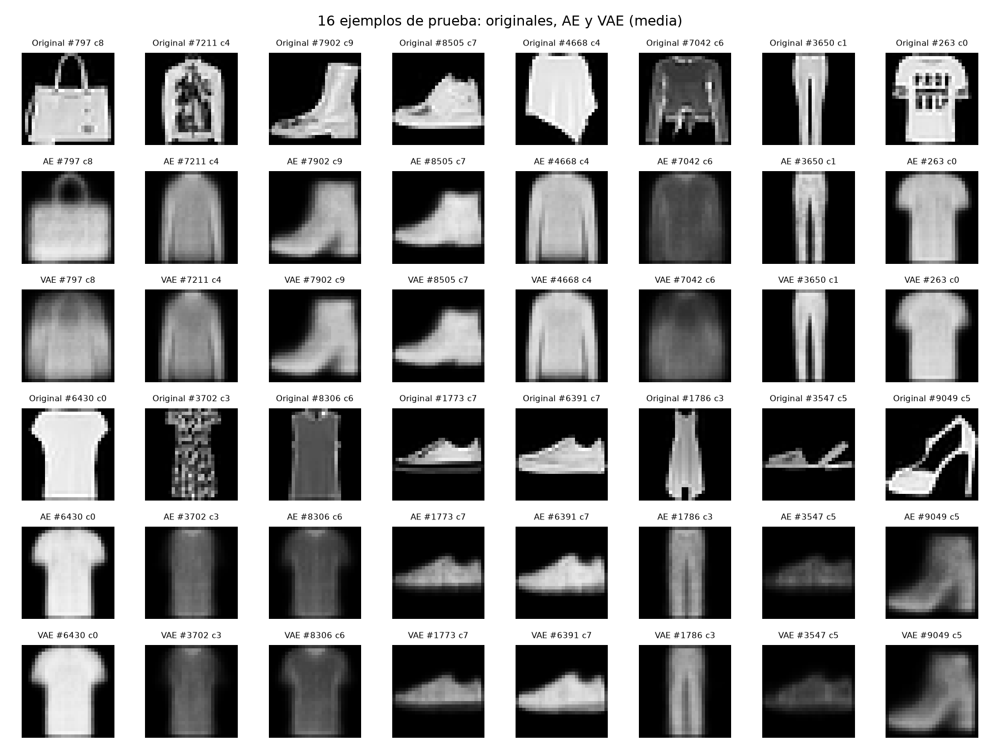
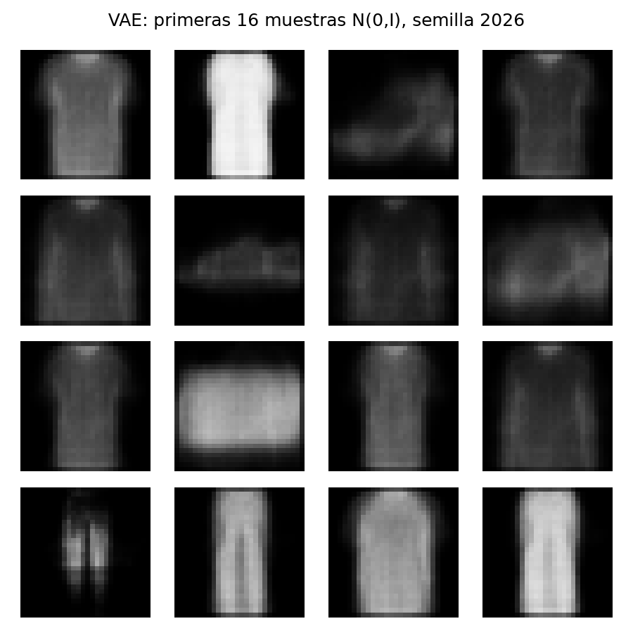

# U03 · LAB10 · Autoencoder y VAE con Fashion-MNIST

**Victor Manuel Perez Padilla · 100801946 · INF-8239 · UASD.** Guía docente: Edwin Ramón José Nolasco.

[Informe PDF](output/pdf/Unidad_03_Ejercicio_06_Victor_Perez.pdf) · [Notebook ejecutado](notebooks/LAB10_AE_VAE.ipynb) · [Model Card](MODEL_CARD.md) · [Declaración de IA](AI_USE_DECLARATION.md) · [Resultados](reports/metrics.csv)

Este proyecto está aislado del recomendador: tiene su propio `pyproject.toml`, `uv.lock` y `.venv`. **El ZIP docente no estaba disponible: el enlace respondió HTTP 403.** Esta es una implementación propia conforme a la guía, sin afirmar equivalencia con la base oficial. La actividad anterior permanece en la raíz del repositorio.

## Ejecutar en CPU desde esta carpeta

Instale [uv](https://docs.astral.sh/uv/getting-started/installation/), clone el repositorio y entre en `generativos/`:

```bash
uv python install 3.12
uv sync --locked --extra cpu
uv run --extra cpu python scripts/check_runtime.py
uv run --extra cpu pytest -q
uv run --extra cpu python scripts/build_notebook.py
uv run --extra cpu streamlit run app/streamlit_app.py
```

Los modelos entrenados se incluyen en `models/`; el notebook comprueba sus hashes y vuelve a calcular la reconstrucción sobre las 10,000 imágenes de prueba. Descarga Fashion-MNIST oficial si falta, a una caché ignorada por Git. `RETRAIN=False` conserva los checkpoints y costos publicados; cambiarlo a True vuelve a entrenar. Jupyter debe poder abrir puertos locales. En un entorno restringido podrían requerirse permisos para el kernel o el directorio temporal de pytest.

Para entrenar desde cero y reconstruir todas las evidencias:

```bash
uv run --extra cpu python scripts/train_ae_vae.py --epochs-ae 6 --epochs-vae 8
uv run --extra cpu python scripts/build_notebook.py
uv run --extra cpu python scripts/build_report.py
```

En CPU lenta se admite `--limit 10000`: limita únicamente fit, manteniendo validación y prueba. Cambia el experimento y sus resultados; no reproduce la tabla completa publicada. La ejecución entregada usa **50,000 fit, 10,000 validación y 10,000 prueba, sin limit**. La dimensión latente está fijada en 2 para inspección directa.

Alternativa pip en entorno **Python 3.12 independiente**:

```bash
python -m pip install -r requirements.txt
python -m pip install --no-deps -e .
python scripts/check_runtime.py
python scripts/build_notebook.py
streamlit run app/streamlit_app.py
```

GPU opcional: en WSL2/Linux con NVIDIA configurada, usar `uv sync --extra gpu` y comandos `uv run --extra gpu ...`. No combinar extras CPU/GPU. Esta entrega se ejecutó en CPU nativa Windows; la ruta GPU no se verificó. No instalar TensorFlow en el entorno del recomendador.

## Resultados reales

Python 3.12.14, TensorFlow 2.21.0, Keras 3.15.1, CPU, semilla 42, 23 de octubre de 2026. Adam .001, batch 256, beta KL=1. AE y VAE tienen casi la misma capacidad; los presupuestos de épocas son diferentes. Se guarda el mejor punto de validación, sin seleccionar con prueba.

| Modelo | MSE prueba | BCE/píxel | Épocas | Tiempo fit (s) | Parámetros | Modelo MB |
|---|---:|---:|---:|---:|---:|---:|
| Imagen media de fit | 0.086641 | 0.491094 | 0 | No medido | 784 | 0.0031* |
| AE | 0.028717 | 0.327269 | 6 | 7.70 | 469,010 | 1.922 |
| VAE (media posterior) | 0.030226 | 0.331847 | 8 | 9.94 | 469,268 | 1.926 |

*Baseline: bytes de 784 float32 sin contenedor; los otros son tamaños reales `.keras`, sin optimizador. El tiempo incluye entrenamiento, validación, trazado y restauración del checkpoint, sin descarga, figuras ni serialización. No se midió costo del baseline, energía, CO2 ni pico de RAM. Inferencia de 10,000: AE .246 s, VAE .243 s. La app solo usa decoder de .963 MB; instalar TensorFlow requiere mucho más espacio que ese archivo.

Reconstrucción VAE decodifica la media; adicionalmente, una muestra posterior fija obtiene MSE .030705. KL medio de prueba 6.0725 nats. BCE de entrenamiento se suma sobre píxeles y se promedia sobre batch; la tabla divide por 784. Las etiquetas no son entrada del modelo. No se entrenaron GAN ni transferencia: su comparación es conceptual en la Model Card.

## Evidencias visuales y límites



Los 16 índices se muestrean sin reemplazo con semilla 2026; no se eligen imágenes por desempeño. Los títulos compactos usan `c0` a `c9`: camiseta, pantalón, pulóver, vestido, abrigo, sandalia, camisa, zapatilla, bolso y botín. AE borra estampados; VAE cambia la silueta del bolso #797. Bag tiene mayor MSE en ambos modelos, sin que eso sea una prueba de clasificación o de equidad.



Las primeras 16 de 256 muestras normales tienen formas variadas, pero son borrosas y algunas ambiguas. El AE con ese prior arbitrario produce muestras oscuras y poco variadas: el AE no aprendió a ajustar su latente a N(0,I). Comparar ese caso no descarta otras estrategias de generación AE.

- `curves.png`: reconstrucción fit/val, KL y loss total VAE.
- `samples_ae.png`: mismo prior sin calibración en AE.
- `interpolation.png`: AE entre las dos primeras entradas del panel; VAE entre dos puntos del prior, ambos fijos y sin selección estética.
- `latent_space.png` y `latent_grid.png`: latente 2D y cuadrícula de decodificación. Sus ejes no tienen significado garantizado.
- `nearest_neighbors.png/csv`: 256 muestras contra los **50,000** ejemplos fit, guardando los primeros 16 pares y los índices de todos los vecinos.
- `diagnostics.json`: diversidad, vecinos, KL y varianzas latentes; `class_errors.csv`: errores por clase.

MSE medio entre pares: VAE .08777, AE-prior .00628; referencia de 16 originales .21547. MSE medio al vecino de fit: VAE .01021, frente a .02284 de los 16 originales de prueba. No se hallaron distancias cero; los outputs suavizados pueden acercarse a prototipos. Estas medidas **no prueban realismo, privacidad, originalidad ni cobertura semántica**; no se realizó auditoría formal de memorización ni FID.

Decisión: AE para estudiar compresión/reconstrucción y VAE para estudiar muestreo y regularización. Uso exclusivamente académico, sin garantía para catálogo comercial. Próximo experimento: comparar igual presupuesto, varias semillas, mayor latente y redes convolucionales; validar calidad y diversidad con criterios apropiados y reservar otra prueba al ajustar modelos.

## Calidad, datos y publicación

**9 pruebas locales aprobadas**, incluida recarga `.keras`, gradientes y Streamlit. Keras emite avisos de deprecación internos con NumPy, registrados sin ocultar fallos. CI en GitHub ejecuta las pruebas con TensorFlow aislado. El notebook verifica hashes y recalcula MSE en la prueba; no inventa métricas ni reatribuye a su ejecución los tiempos del entrenamiento anterior.

La app carga `models/decoder.keras` por ruta relativa; ofrece semilla, 16 muestras y dos controles latentes. No entrena ni descarga el dataset por visita. Para nube se proporciona `requirements-cloud.txt` (inferencia), pero no se ha realizado despliegue público. Fuente, método y límites aparecen en la interfaz; no se requieren credenciales.

Los datos se descargan del repositorio oficial fijado por commit; cuatro hashes SHA-256 y fechas constan en `reports/download_manifest.json`. Los modelos llevan hashes en `models/manifest.json`. No se incluye la descarga completa, `.venv`, secretos ni MovieLens. Fashion-MNIST usa [licencia MIT](docs/FASHION_MNIST_LICENSE.txt); se conserva su aviso para los ejemplos visuales. [Repositorio oficial](https://github.com/zalandoresearch/fashion-mnist) · [Xiao et al., 2017](https://arxiv.org/abs/1708.07747) · [Kingma y Welling, 2013](https://arxiv.org/abs/1312.6114).

El PDF sigue el formato personal de Unidad 02, Ejercicio 03: carta, Calibri si está disponible (Helvetica alternativa), títulos azules, tablas y pie con nombre completo. No se redistribuye la fuente tipográfica. Codex apoyó el trabajo según [declaración](AI_USE_DECLARATION.md). El estudiante debe revisar, reproducir y explicar los resultados antes de entregar.
