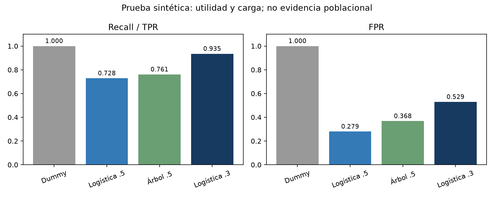

# Unidad 04 · Impacto, equidad y DSS gobernado

**Victor Manuel Perez Padilla · 100801946 · INF-8239 · UASD.** Guía docente: Edwin Ramón José Nolasco.

[Ejercicio 07 · PDF](output/pdf/Unidad_04_Ejercicio_07_Victor_Perez.pdf) · [Ejercicio 08 · PDF](output/pdf/Unidad_04_Ejercicio_08_Victor_Perez.pdf) · [Decisión](reports/lab11/DECISION_RECORD.md) · [Model Card](docs/MODEL_CARD.md) · [Dataset Card](docs/DATASET_CARD.md) · [Runbook](docs/RUNBOOK.md) · [IA](docs/AI_USE_DECLARATION.md)

Proyecto acumulativo LAB11–13 a partir de la base local suministrada `INF8239_U04_Gobernanza_DSS_Proyecto_Base_uv`. Una sola copia de trabajo en `unidad04/`, con entorno y lock independientes del recomendador y del proyecto TensorFlow. Se publican artefactos editables, código, pruebas y evidencia; no solo capturas. No se modifica la demostración DSS independiente del curso.

## Decisión y valores

El estudiante confirmó **«No omitir zonas que necesitan revisión humana»**. La prioridad orienta recall, junto con el costo humano de falsos positivos. Con umbral .3, la logística obtiene recall .9348 frente a .7283 a .5, pero FPR sube de .2794 a .5294. Se omiten 6 de 92 positivos, frente a 25, y se alertan 36 de 68 negativos, frente a 19. No se ha validado capacidad operativa de revisión.

**LIMITAR al laboratorio; REVIEW para despliegue.** Solo 1/8 intersecciones tiene soporte suficiente bajo la política propuesta. Las brechas interseccionales no estimables se registran como null/NaN y fallan la puerta; no se afirma que se midió una brecha excesiva. El simulacro deja **MANUAL_ONLY**, bloquea cargar el modelo y mantiene cola humana completa, sin descartar casos por score.

El fixture es completamente sintético: no representa personas, territorios ni tasas reales de República Dominicana. Sus fechas de 2026, incluso posteriores a la fecha de entrega, son inventadas y no evidencia histórica. No se ha autorizado uso operativo ni realizado consulta pública real.

## Reproducir

Con [uv](https://docs.astral.sh/uv/getting-started/installation/), desde `unidad04/`:

```bash
uv python install 3.12
uv sync --frozen
uv run pytest -q
uv run python scripts/check_environment.py
uv run python scripts/describe_dataset.py
uv run python scripts/lab11_impact.py
uv run python scripts/lab12_audit.py --model all
uv run python scripts/validate_lab12_decision.py
uv run python scripts/lab13_governance.py
uv run python scripts/simulate_incident.py
uv run python scripts/complete_evidence.py
uv run pytest -q
uv run python scripts/build_reports.py
uv run streamlit run app.py
```

LAB12 siempre conserva la comparación común completa aunque se use `--model logistic` o `--model tree`, evitando sobrescribir alternativas incompatibles. Los tiempos cambian entre ejecuciones; regenerar informes después de cambiar métricas. LAB11 preserva el registro de decisión ya redactado; `complete_evidence.py` reconstruye su síntesis a partir de resultados y supuestos declarados.

`app.py` carga informes y realiza inferencia solo si la política lo permite; no reentrena al visitar. Tras el simulacro no puntúa: muestra la cola manual y conserva evidencia de prueba separada. Repetir LAB13 no borra silenciosamente el estado de rollback. No existe botón de reactivación sin aprobación humana.

Alternativa pip: crear entorno Python 3.12, `pip install -r requirements-dev.txt`, después `pip install --no-deps -e .`. `requirements.txt` sirve para app/ejecución sin herramientas de informe; `requirements-dev.txt` incluye pruebas y PDF. No instalar en los entornos anteriores. La nube es opcional y no se ha desplegado públicamente; si se usa, la entrada es `unidad04/app.py` y deben respetarse las rutas de dependencias de esta carpeta.

## Tabla principal · prueba temporal sintética

| Modelo / umbral | Accuracy | Recall | FPR | Selección | Brecha recall | Brecha FPR |
|---|---:|---:|---:|---:|---:|---:|
| Dummy .5 | .5750 | 1.0000 | 1.0000 | 1.0000 | .0000 | .0000 |
| Logística .5 | .7250 | .7283 | .2794 | .5375 | .1172 | .1250 |
| Árbol .5 | .7063 | .7609 | .3676 | .5938 | .0123 | .2548 |
| Logística .3, elegida en validación | .7375 | .9348 | .5294 | .7625 | .0085 | .0433 |

Fuente: [comparison.csv](reports/lab12/comparison.csv), [candidatos de validación](reports/lab12/validation_candidates.csv), [selección congelada](reports/lab12/selection.json). Dummy es mayoría de fit y predice todo positivo; no equivale a la alternativa de revisión humana. Recall 1 y brechas cero no bastan para elegirlo.

384 fit, 96 validación, 160 prueba; días empatados permanecen juntos. Solo fit aprende transformaciones y modelos. El umbral se escoge antes de acceder a prueba; no se reentrena sobre validación. Predictores: zona, incidentes previos, índice de infraestructura y exposición. **protected_group y age_band excluidos**; corregimos la inclusión de age_band en la base. Zona puede funcionar como proxy y quitar sensibles no elimina sesgo indirecto.



G1 n=101 (49 positivos/52 negativos) y G2 n=59 (43/16). Con .3, recall G1 .9388 y G2 .9302, FPR .5192 y .5625. Todos los grupos/intersecciones aparecen en CSV con conteos por clase y Wilson95%. Soporte propuesto n>=30, positivos>=10 y negativos>=10; grupos insuficientes se muestran, sin afirmaciones robustas. Wilson no corrige correlación temporal ni comparaciones múltiples. Las diferencias no prueban discriminación causal.

Green AI: tiempo de fit, tamaño joblib en KiB y latencia batch por registro están en comparison.csv. Se prefirió la logística elegida en validación frente a complejidad adicional del árbol; el tamaño del árbol es mayor y su brecha FPR peor a .5. Tiempos son locales y pequeños, no benchmarks robustos; no se midió energía ni emisiones. La latencia media por registro no es p95 de una petición.

## Evidencia por ejercicio

- **E07:** `student_inputs/lab11_impact.yml`, stakeholders y doce riesgos específicos; registro puntuado, resumen de cuatro funciones NIST, auditoría global/G1G2/interseccional, comparación de alternativas y decisión con retiro/apelación.
- **E08:** inventario y retención, [RACI](student_inputs/raci.csv), [traspasos](docs/HANDOFF.md), Model/Dataset Card, puertas, [monitoreo](reports/lab13/monitoring.json), runbook y [simulacro/postmortem](reports/lab13/INCIDENT_POSTMORTEM.md).
- **Trazabilidad:** hash del fixture, política, modelos y fuentes en `reports/lab13/provenance.json`, `models/manifest.json` y `deployment_decision.json`; evidencia obsoleta bloquea inferencia.
- **Privacidad:** contrato antes de predecir, allowlist, rechazo de identificadores y exclusión de sensibles; retención propuesta y dry-run con hold, sin borrar evidencia real.
- **Pruebas:** datos, privacidad, impacto, modelos, Fairlearn, RACI, puertas, rollback y Streamlit. Resultado ejecutado en `reports/tests.txt`; CI verifica en otro sistema sin entrenamiento costoso.

Los roles y puntuaciones ordinales son propuestas académicas; RACI no es una firma de aceptación real. Retención30/90/180 y soporte30/10 no son plazos ni estándares legales. Se conservan los umbrales de desempeño/brechas de la base, sin moverlos para aprobar pruebas. Una recomendación técnica GO nunca sería autorización de uso real.

## Normativa y responsabilidad

[Matriz normativa](docs/NORMATIVE_FRAMEWORK.md): Ley172-13 para analizar el tratamiento de datos personales cuando corresponda; NIST AI RMF1.0 y principios OCDE como orientación voluntaria; revisión humana, participación y tolerancias como propuestas éticas del caso. No se atribuye validez legal a un umbral de equidad ni se certifica cumplimiento por pasar tests.

La semilla generadora del CSV no estaba incluida y no se inventa. Se preserva el fixture original por SHA-256 y bytes CRLF con `.gitattributes`; no se modificó para favorecer resultados. La base no aporta licencia explícita para otros usos: se entrega como material académico suministrado, sin atribuir permiso comercial ni licencia abierta inexistente.

Codex apoyó código, pruebas y redacción según [declaración de IA](docs/AI_USE_DECLARATION.md). El estudiante eligió el daño prioritario; debe revisar las restantes propuestas, supuestos y conclusiones y defender la entrega. No se inventan firmas, comunicaciones ni aprobaciones institucionales.
